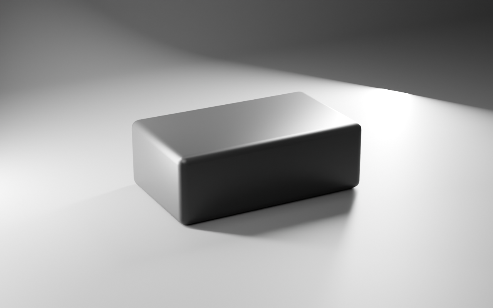

# Quick Product Studio

A free, one-click product photography setup for Blender 4.2+.

Select your object(s), click **Build Product Studio**, and you get a seamless cyclorama backdrop, studio lighting, and a camera framed on your part, all sized to the object automatically. It works the same for a 10 mm part as for a 2 m one.



## What it builds

Everything goes into a `Product Studio` collection:

- **Seamless cyclorama backdrop** with a matte material by default. Its colour and gloss update live, so dark or black backdrops really do render dark.
- **Key light** aimed at the centre of the object.
- **One or two narrow rim lights** for edge highlights, which matter a lot for dark or black plastic. They use Cycles light linking, so they light only the product, not the backdrop.
- **Soft fill light** and a **top strip light**.
- **85 mm camera** framed on the object.

It also switches the scene to Cycles with AgX (Medium High Contrast).

What it leaves alone:

- Your existing world and HDRI are never touched. A dim neutral world is created only if the scene has no world at all.
- Your objects are never modified.
- Light emitters are hidden from the camera.
- Running it again replaces the previous setup instead of stacking a new one.

## Install

1. Download the latest `quick_product_studio.zip` from [Releases](../../releases), or build it yourself (see below).
2. In Blender, go to **Edit > Preferences > Get Extensions**.
3. Open the dropdown at the top right, choose **Install from Disk...**, and pick the zip.

## Use

Open the **Product Studio** tab in the 3D View sidebar (press `N`), or use **Object > Build Product Studio**.

| Option | What it does |
| --- | --- |
| Light Intensity | Multiplier on all studio lights |
| Backdrop Colour | Backdrop base colour (updates live) |
| Backdrop Gloss | Backdrop shininess, 0 is matte (updates live) |
| Rim Lights | Both, Left, or Right |
| Build Product Studio | Creates or rebuilds the setup around the selection |
| Remove Product Studio | Deletes the setup |

### Tips

- Model at real size and apply scale (`Ctrl+A > Scale`). Lights and camera are sized from the object's bounding box.
- The camera looks from the front (along -Y), so orient your part so its front faces -Y.
- Parts imported from CAD as STLs in millimetres (scene Unit Scale 1) come in at true size and work as-is.

## Build the zip

From the repository root:

```bash
zip -r quick_product_studio.zip quick_product_studio
```

On Windows PowerShell:

```powershell
Compress-Archive -Path quick_product_studio -DestinationPath quick_product_studio.zip -Force
```

## License

GPL-3.0-or-later (see [LICENSE](LICENSE)), as required for Blender add-ons.
